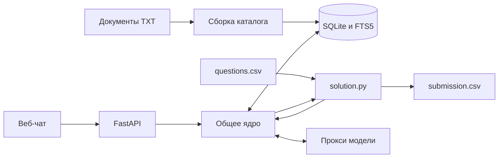

# HackChange — юридический ассистент ПСБ

Ассистент помогает сотрудникам находить применимые положения в договорах, внутренних регламентах и выдержках из законов из базы организаторов. Ответ опирается на найденные документы. В веб-чате можно задать уточняющий вопрос, открыть дословную цитату и увидеть её в полном тексте источника.

Одно ядро обслуживает веб-чат и пакетную обработку вопросов для платформы Hack&Change. Оба режима используют одни и те же правила поиска, выбора редакции и проверки ответа.

## Быстрый старт

Понадобятся Python 3.11+ с поддержкой SQLite FTS5, Docker с Compose, архив `knowledge-base.zip` и доступ к прокси модели. Команды ниже приведены для PowerShell. Архив доступен в папке [материалов организаторов](https://drive.google.com/drive/folders/1lendasLVlcKUcuM8mOrWKHD-C2dWtm9F).

1. Клонируйте репозиторий и положите `knowledge-base.zip` в его корень.

   ```powershell
   git clone https://github.com/vakenris/hack-and-change-2026.git
   cd hack-and-change-2026
   ```

2. Распакуйте архив и соберите каталог. Сборщик читает 21 исходный TXT и создаёт `data/processed/knowledge.sqlite` и `manifest.json`.

   ```powershell
   python -m zipfile -e knowledge-base.zip data/raw
   python -m scripts.build_knowledge
   Copy-Item .env.example .env
   ```

3. Заполните `.env`. Для запуска с корпусом и моделью используйте доступный вам OpenAI-совместимый прокси с DeepSeek V4.1 Flash и оставьте `ASSISTANT_STUB=0`. Исходные TXT, собранная база и `.env` хранятся локально.

   | Переменная | Назначение |
   | --- | --- |
   | `LLM_BASE_URL` | Базовый адрес прокси. Клиент добавляет путь `/chat/completions`. |
   | `LLM_API_KEY` | Ключ доступа к прокси. |
   | `LLM_MODEL` | Идентификатор модели в конфигурации прокси. |
   | `ASSISTANT_STUB` | `0` запускает основное ядро. `1` включает заглушку для демонстрации интерфейса на условных данных. |
   | `KNOWLEDGE_DB` | Необязательный путь к SQLite внутри среды запуска. По умолчанию `data/processed/knowledge.sqlite`. |

4. Запустите веб-приложение.

   ```powershell
   docker compose up --build
   ```

Откройте [веб-чат](http://localhost:8000). Описание методов доступно в [документации API](http://localhost:8000/docs). Чтобы остановить приложение, выполните `docker compose down`.

## Сценарии использования

Сценарии ниже описывают ожидаемое поведение на выданных документах в режиме `ASSISTANT_STUB=0`. Для каждого сценария начните новый диалог.

| Сценарий | Что ввести или сделать | Что проверить |
| --- | --- | --- |
| Условия договора | «Какая арендная плата по договору № А-08/2024 и когда её вносить?» | Ответ опирается на пп. 3.1 и 3.2. В базе указаны 450 000 рублей в месяц, включая НДС, и срок не позднее 5-го числа текущего месяца. Нажмите на источник, затем на «Открыть документ». Цитата должна совпасть с выделенными строками. |
| Уточнение в диалоге | «Какой адрес доставки по договору П-17/2024?» После запроса даты ответьте «Спецификация подписана 02.10.2024». | Система сохраняет договор из первой реплики и использует дату подписания спецификации. Подтверждение адреса открывается в п. 3.2 в редакции допсоглашения № 1. При дате 01.10.2024 применяется исходный пункт. |
| Редакция на дату сделки | «В августе 2024 года заключили договор на 12 млн рублей. Нужно ли было одобрение генерального директора?» | Вывод относится к редакции регламента от 10.01.2023. Пункт 2.4 устанавливает порог свыше 10 млн рублей на тот период. |
| Сравнение периодов | «Требовалось ли одобрение генерального директора для договора на 12 млн в августе 2024 и марте 2025?» | Для каждого периода есть отдельный вывод и ссылка на соответствующую редакцию п. 2.4 регламента. |
| Неоднозначный контрагент | «Какой гарантийный срок по договору с „Альфой“?» | Ассистент перечисляет договоры П-17/2024 и ПТ-05/2023, затем просит уточнить контрагента или номер договора. |
| Нет оснований в базе | «Какой размер пособия по беременности и родам?» | В выданном корпусе нет нужного документа. Ассистент сообщает о нехватке оснований и воздерживается от расчёта суммы. |

## Архитектура



**Подготовка документов.** Сборщик разбирает статьи, пункты и фрагменты, сохраняет исходный текст, номера строк и метаданные редакций. Поисковый индекс и оригиналы входят в один файл SQLite. Манифест фиксирует состав корпуса, количество фрагментов, контрольные суммы и ошибки сборки.

**Обработка вопроса**

1. Модель извлекает реквизиты, ключевые факты и тип даты с учётом предыдущих реплик.
2. Ядро ищет основания для каждой части вопроса отдельно и объединяет результаты. FTS5 с BM25 учитывает текст фрагмента, заголовки и контекст положения.
3. Ядро выбирает применимую редакцию для каждого указанного периода. Для П-17/2024 выбор адреса зависит от даты подписания спецификации.
4. Модель формулирует тезисы на основании выбранных фрагментов. Ядро сверяет идентификаторы ссылок с каталогом и контекстом, затем отдельный вызов модели проверяет, поддерживают ли фрагменты каждый тезис.
5. Политика ответа выбирает полный ответ, частичный ответ, запрос недостающего факта или отказ. Ядро читает цитаты и координаты из SQLite. Веб и CSV показывают основания рядом с выводом, к которому они относятся.

История веб-чата хранится в текущей сессии браузера и передаётся в `POST /api/chat`. Маршруты `GET /api/sources/{fragment_id}` и `GET /api/documents/{document_id}` читают каталог напрямую, поэтому для открытия источника вызов модели не требуется.

## Стек и выбор решений

| Часть | Технологии | Причина выбора |
| --- | --- | --- |
| Веб-интерфейс | HTML, CSS, JavaScript | Для чата и панели источников достаточно браузерных API. Интерфейс раздаётся тем же приложением, отдельная сборка фронтенда не требуется. |
| API и ядро | Python 3.11+, FastAPI, Uvicorn | FastAPI проверяет структуру запросов и отдаёт JSON. Python позволяет использовать то же ядро в вебе и в `solution.py`. |
| Хранилище и поиск | SQLite, FTS5, BM25 | Для корпуса кейса достаточно встроенного индекса. Один файл содержит каталог документов, исходный текст и поисковые данные, поэтому его удобно переносить и включать в ZIP. |
| Генерация и проверка | DeepSeek, OpenAI-совместимый прокси, HTTPX | Модель формулирует выводы на естественном языке. Даты действия и принадлежность ссылок проверяет код. Адрес прокси, ключ и идентификатор модели задаются через окружение. |
| Запуск | Docker и Docker Compose | Один контейнер обслуживает веб и API, а собранный каталог подключается с хоста в режиме чтения. |

## Структура проекта

```text
.
├── assistant_core/
│   ├── assistant_service.py     # Общий сценарий обработки вопроса
│   ├── contracts.py             # Типы сообщений, фрагментов и ответов
│   ├── knowledge_store.py       # Чтение SQLite и нормализация реквизитов
│   ├── retrieval.py             # Поиск по реквизитам и полнотекстовый поиск
│   ├── versions.py              # Применимость редакций и допсоглашений
│   ├── llm_client.py            # Вызовы модели и разбор её ответов
│   ├── llm_prompts.py           # Инструкции для извлечения, генерации и проверки
│   ├── citations.py             # Проверка ссылок и сборка карточек источников
│   ├── answer_policy.py         # Выбор статуса и формулировка результата
│   ├── runtime.py               # Бюджет запроса и замер времени по этапам
│   └── stubs.py                 # Заглушка для запуска интерфейса
├── backend/app/
│   ├── main.py                  # FastAPI и раздача фронтенда
│   └── api/
│       ├── chat.py              # Диалог и сериализация ответа
│       └── sources.py           # Карточки и полный текст документов
├── frontend/
│   ├── index.html               # Разметка чата
│   ├── chat.js                  # История, запросы и просмотр источников
│   └── styles.css               # Оформление интерфейса
├── scripts/
│   ├── ingestion.py             # Разбор исходных TXT
│   ├── build_knowledge.py       # Сборка SQLite, FTS5 и манифеста
│   ├── package_submission.py    # Упаковка решения для платформы
│   └── evaluate.py              # Замер покрытия оснований на открытом наборе
├── data/
│   ├── raw/                     # Исходные TXT, создаётся локально
│   └── processed/               # SQLite и манифест после сборки
├── docs/                        # Рабочие материалы проекта
├── tests/                       # Тесты ядра, каталога, веб-API и сабмита
├── solution.py                  # Пакетный режим CSV
├── requirements.txt             # Зависимости проекта
├── submission-requirements.txt  # Зависимости пакетного режима
├── .env.example                 # Шаблон настроек без ключей
├── Dockerfile                   # Образ веб-приложения
└── compose.yaml                 # Запуск сервиса и подключение базы
```

## Эффективность и масштабирование

- **Индекс строится до запуска.** В корпусе кейса 21 документ и 772 фрагмента. Поиск по индексу ограничивает выдачу 12 кандидатами, из которых ядро отбирает контекст для модели. Собранный архив решения с базой занимает около 0,34 МиБ.
- **Пакетный запуск обрабатывает вопросы параллельно.** `solution.py` использует четыре потока по умолчанию. Их число задаётся через `MAX_WORKERS`. Строки обрабатываются независимо, порядок выходных идентификаторов сохраняется. По истечении бюджета обработанные ответы сохраняются, а ID незавершённых вопросов получают сообщение о технической ошибке.
- **Веб-реплики могут работать с одинаковыми копиями каталога.** API получает историю в каждом запросе, поэтому серверу не требуется общее хранилище сессий. При росте нагрузки на поиск можно отдельно развивать индекс и ранжирование через слой хранилища и поиска, сохранив интерфейс ядра для веба и CSV.
- **Задержка зависит от прокси.** Для полного ответа ядро может сделать до трёх последовательных запросов к модели. Повышать параллелизм имеет смысл по результатам замера времени обработки, частоты ошибок и ограничений прокси. Нагрузочные показатели проекта не измерены.

## Ограничения

- Ассистент работает с предоставленным корпусом. Если применимая редакция закона отсутствует в выгрузке, для вывода на эту дату может не хватить оснований.
- Текстовый поиск может пропустить нужное положение в длинной статье или в вопросе, который требует нескольких документов. Проверка ссылок и тезисов опирается на отобранные фрагменты.

## Сборка для платформы

После сборки каталога выполните команду из корня проекта.

```powershell
python scripts/package_submission.py --output dist/submission-current.zip
```

Архив содержит `solution.py`, модули ядра, файл зависимостей и готовый `knowledge.sqlite`. Платформа передаёт параметры модели через окружение. Скрипт читает `questions.csv` из `DATA_DIR` (по умолчанию `data/`) и записывает `submission.csv` со столбцами `id,answer`.
