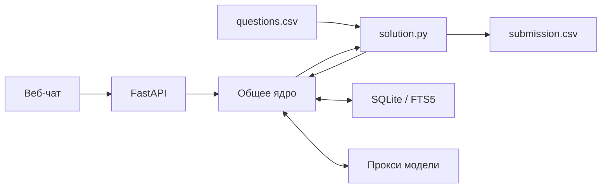

# HackChange — юридический ассистент ПСБ

Веб-ассистент для поиска ответов по договорам, внутренним регламентам и выдержкам из законов из базы организаторов. В чате можно уточнить вопрос и открыть источник, на котором основан ответ.


## ✨ Основные возможности

- Веб-чат с уточняющими вопросами и учётом истории диалога.
- Поиск положений по реквизитам документа и по формулировке вопроса.
- Выбор редакции с учётом даты события и условий допсоглашений.
- Карточки источников с названием документа, редакцией, дословной цитатой и номерами строк.
- Частичный ответ, запрос недостающих сведений или отказ, если в базе нет основания для вывода.
- Пакетная обработка вопросов из CSV для платформы хакатона.

## 🛠️ Технологии

| Часть | Стек |
| --- | --- |
| Интерфейс | HTML, CSS, JavaScript |
| API и ядро | Python 3.11+, FastAPI, Uvicorn |
| Данные и поиск | SQLite, FTS5 |
| Модель | DeepSeek через OpenAI-совместимый прокси |
| Запуск и тесты | Docker Compose, pytest |

## 🏗️ Архитектура



Модель извлекает из вопроса факты и помогает составить и проверить выводы. Ядро ищет применимые положения и берёт цитаты из каталога исходных документов. Веб-чат передаёт историю диалога, а `solution.py` обрабатывает каждую строку CSV независимо.

## 🚀 Быстрый старт

Понадобятся Python 3.11 или новее, Docker Desktop, архив `knowledge-base.zip` от организаторов и доступ к прокси модели. Команды приведены для PowerShell.

```powershell
git clone https://github.com/vakenris/hack-and-change-2026.git
cd hack-and-change-2026
New-Item -ItemType Directory -Force data/raw
```

Распакуйте `knowledge-base.zip` в `data/raw/`. Скрипт ищет в этой папке 21 исходный TXT и собирает `data/processed/knowledge.sqlite`.

```powershell
python -m scripts.build_knowledge
Copy-Item .env.example .env
```

Заполните в `.env` параметры `LLM_BASE_URL`, `LLM_API_KEY` и `LLM_MODEL`. Для работы с реальной базой и моделью оставьте `ASSISTANT_STUB=0`. Исходные TXT, база и `.env` хранятся локально и исключены из Git.

```powershell
docker compose up --build
```

- [Веб-чат](http://localhost:8000)
- [Документация API](http://localhost:8000/docs)

Для остановки выполните `docker compose down`.

## 📱 Интерфейс

Чтобы начать работу, задайте вопрос в чате. Уточнение можно отправить следующим сообщением. Нажмите на ссылку под ответом, чтобы открыть карточку источника, прочитать цитату и перейти к полному тексту документа.

## 📦 Сборка для платформы

После подготовки актуальной базы выполните команду из корня проекта.

```powershell
python scripts/package_submission.py --output dist/submission-current.zip
```

В ZIP входят `solution.py`, модули ядра, зависимости и готовая SQLite. На платформе скрипт читает `questions.csv` из `DATA_DIR` (по умолчанию `data/`) и записывает `submission.csv` со столбцами `id,answer`. Параметры модели платформа передаёт через окружение.

## 📚 Документация и проверки

- [Заметки по проверке на вопросах организаторов](docs/evaluation.md)
- [Авторы и участники проекта](https://github.com/vakenris/hack-and-change-2026/graphs/contributors)

```powershell
python -m pip install -r requirements.txt
$env:KNOWLEDGE_DB = (Resolve-Path data/processed/knowledge.sqlite).Path
python -m pytest -q
```
